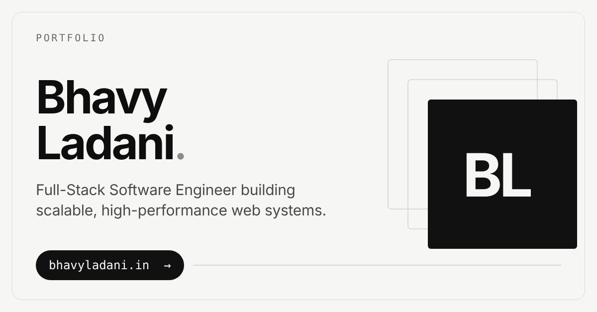
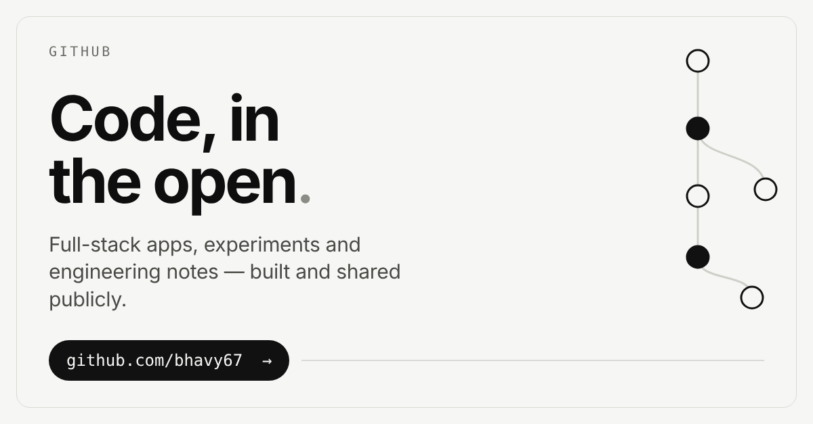
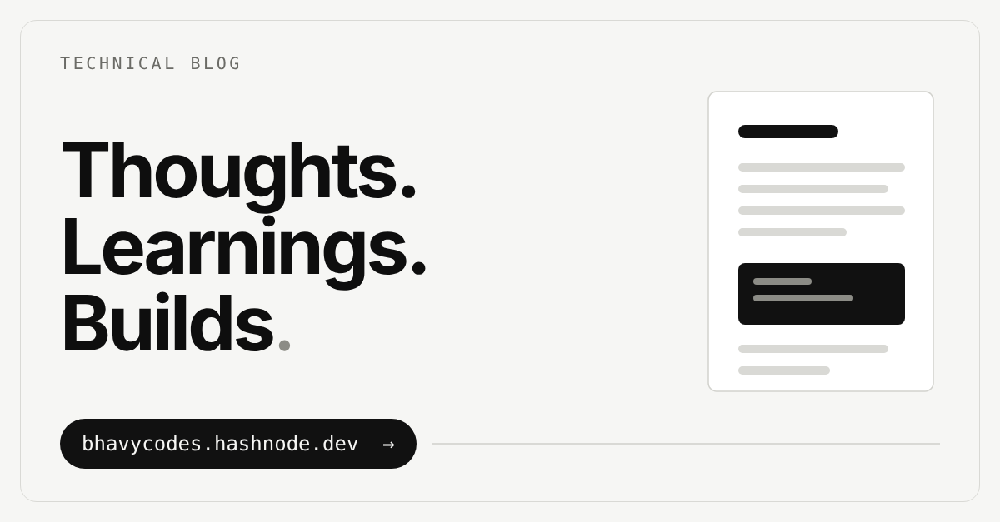

# brand-system

One visual and written system for everything I publish: profile photo, logo, covers, blog images, diagrams, post graphics, carousels and LinkedIn posts. Monochrome, light, minimal, neutral.

## Featured set

| Portfolio | GitHub | Blog |
|---|---|---|
|  |  |  |

## Contents

- [`DESIGN_RULES.md`](DESIGN_RULES.md): principles, tokens, typography, layout, anti-slop rules, and specs for every asset type (logo, profile photo, covers, blog covers, diagrams, posts, carousels, screenshots)
- [`CONTENT_RULES.md`](CONTENT_RULES.md): voice, post ideas, structure, claims, anti-slop for writing
- [`tokens/tokens.css`](tokens/tokens.css): colour, type and spacing tokens
- [`templates/`](templates): editable HTML sources and a Playwright render script
- [`assets/`](assets): logo (SVG/PNG), LinkedIn cover, blog cover, post and carousel templates, diagram example, featured cards
- [`linkedin/`](linkedin): LinkedIn post playbook: post types, hooks, endings, image modes and generation rules, originality checks, brief template and a `posts/` log
- [`skills/`](skills): `brand-visuals`, `brand-content` and `linkedin-post` skills for Claude

## Make a new asset

```bash
npm i playwright
# edit templates/featured-cards.html or templates/assets.html
node templates/render.js
```

Check it at full size and at about 185px wide, then run the slop test in `DESIGN_RULES.md`.

## Use with Claude

Copy `skills/brand-visuals/`, `skills/brand-content/` and `skills/linkedin-post/` into your Claude skills folder, or point Claude at this repo's `CLAUDE.md`.
